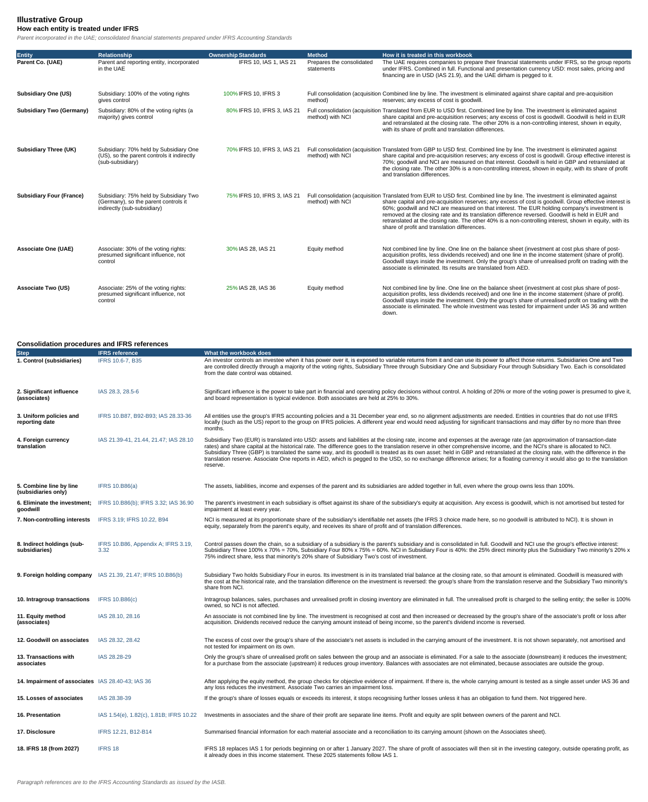
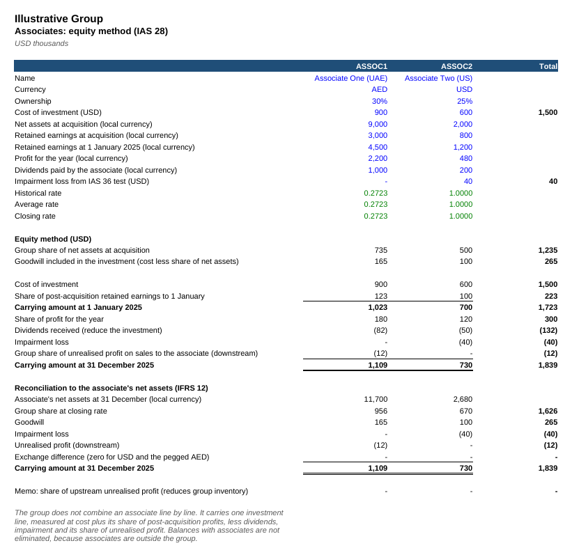

# Multi-Entity Consolidation Workflow

A Python workflow that consolidates a UAE parent, four subsidiaries (including two sub-subsidiaries owned through other subsidiaries, one of them via a euro holding company) and two associates into group financial statements under IFRS, with currency translation, intercompany eliminations, goodwill, non-controlling interests and the equity method. The output is an Excel workbook where every step is a formula, including a sheet that explains how each entity is treated under IFRS.

**Downloads:** [⬇ Consolidation workbook (Excel)](https://github.com/MuhammedAnshajK/consolidation-workflow/raw/main/output/group_consolidation.xlsx) · [⬇ PDF version](https://github.com/MuhammedAnshajK/consolidation-workflow/raw/main/output/group_consolidation.pdf) · [⬇ Python script](https://github.com/MuhammedAnshajK/consolidation-workflow/raw/main/consolidate.py) · [⬇ Sample trial balances](https://github.com/MuhammedAnshajK/consolidation-workflow/raw/main/data/trial_balances.csv)


## What this does

Group reporting means combining several companies' books into one set of accounts, as if they were a single business. That involves converting foreign currencies, removing everything the companies did with each other, separating the share that belongs to minority owners, and bringing in associates (companies the group influences but does not control) as a single equity-method line. This script does it in one run and checks every step:

```
$ python consolidate.py
Checks passed: 5 trial balances balance, 2 associates equity-accounted, 19 elimination entries balance, intercompany fully eliminated, balance sheet balances.
  Revenue                           25,480.0
  Profit for the year                3,608.7
  Attributable to owners             3,368.9
  Attributable to NCI                  239.8
  Share of profit of associates        259.7
  Goodwill                             641.0
  Investment in associates           1,838.6
  Total assets                      24,889.2
  Equity attributable to owners     12,257.7
  Non-controlling interests          1,019.9
  Total liabilities                 11,611.6
  Total equity and liabilities      24,889.2
Saved output/group_consolidation.xlsx
```

## The group

| Entity | Currency | Owned | IFRS treatment | Notes |
|---|---|---|---|---|
| Parent Co. (UAE) | USD | n/a | Reporting entity (IFRS, required in the UAE) | Group parent; functional and presentation currency USD (the dirham is pegged to it) |
| Subsidiary One (US) | USD | 100% | Full consolidation (IFRS 10, IFRS 3) | Bought for 2,700 when its net assets were 2,200, so goodwill = 500 |
| Subsidiary Two (Germany) | EUR | 80% | Full consolidation with NCI (IFRS 10, IAS 21) | Set up by the parent with a partner who holds 20% (non-controlling interest) |
| Subsidiary Three (UK) | GBP | 70% by Subsidiary One | Full consolidation with NCI (sub-subsidiary) | Bought by Subsidiary One for 600; goodwill of GBP 60 retranslated at the closing rate (IAS 21.47) |
| Subsidiary Four (France) | EUR | 75% by Subsidiary Two | Full consolidation with NCI (sub-subsidiary, effective interest 60%) | Bought by Subsidiary Two for EUR 450; held through a partly owned euro holding company |
| Associate One (UAE) | AED | 30% | Equity method (IAS 28) | Parent sells goods to it; 40 of profit on goods it still holds is unrealised |
| Associate Two (US) | USD | 25% | Equity method (IAS 28, IAS 36) | Investment written down by 40 after an impairment test |

All figures are illustrative, in thousands. No real company data is used.

## Approach

1. **Load and validate.** Reads each entity's trial balance, the chart of accounts, group structure, FX rates and intercompany data. Stops if a trial balance doesn't balance, an account is unknown or a rate is missing.
2. **Translate.** Converts Subsidiaries Two and Four from EUR and Subsidiary Three from GBP to USD. Assets and liabilities use the closing rate (EUR 1.08, GBP 1.27), income and expenses the average rate (1.09, 1.28), and share capital the historical rate (1.10, 1.25). The difference goes to a **translation reserve**.
3. **Eliminate the investment.** Removes each holding company's investment against the subsidiary's share capital and pre-acquisition reserves. This creates **goodwill** of 500 for Subsidiary One, 76 for Subsidiary Three and 65 for Subsidiary Four, and a **non-controlling interest** for the shares the group doesn't own.
4. **Handle the sub-subsidiaries.** The parent controls Subsidiary Three through Subsidiary One and Subsidiary Four through Subsidiary Two. Goodwill and NCI are measured on the group's **effective interest**: 100% x 70% = 70% and 80% x 75% = 60%. For Subsidiary Four the Subsidiary Two minority's share of the cost of investment is deducted from NCI. Because Subsidiary Two is a euro company, its investment is removed at the closing rate and the translation difference on it is reversed from the translation reserve (group share) and NCI (minority share). Goodwill of each foreign subsidiary is kept in its own currency and retranslated at the closing rate.
5. **Allocate to NCI.** Gives the minority owners their share of post-acquisition reserves, translation reserve and profit for the year (20% of Subsidiary Two, 30% of Subsidiary Three, 40% of Subsidiary Four).
6. **Eliminate intercompany.** Cancels intercompany balances (150 trade balance, 540 loan), intercompany sales (800), and the **unrealised profit** of 50 on goods still in the parent's inventory.
7. **Equity-account the associates (IAS 28).** Associates are not added line by line. Each one is a single investment line: cost, plus the group's share of profits since acquisition, less dividends received (the parent's dividend income is reversed), less any impairment. Only the group's 30% share of the unrealised profit on sales to Associate One (12) is eliminated. Goodwill stays inside the investment.
8. **Check.** Confirms that every elimination entry balances, intercompany accounts and dividends from associates net to zero, the investment in associates agrees to the equity-method schedule and to the associates' net assets, and the consolidated balance sheet balances.
9. **Write Excel.** The workbook has ten sheets: Consolidated IS and BS, **IFRS Treatment**, the consolidation worksheet, the elimination journal, **Associates**, translation, trial balances, inputs and checks. All of them are formulas, so changing an exchange rate, an ownership percentage or an intercompany amount updates everything.

## IFRS treatment

The **IFRS Treatment** sheet explains, for each entity, why it is a subsidiary or an associate (control under IFRS 10 versus significant influence under IAS 28), which standards apply and how the workbook treats it. It then walks through 18 consolidation steps with paragraph references: control, significant influence, uniform policies, currency translation (IAS 21), goodwill (IFRS 3), NCI, indirect holdings, foreign holding companies, intragroup eliminations, the equity method, goodwill and impairment of associates, unrealised profit with associates, presentation (IAS 1), disclosure (IFRS 12) and the IFRS 18 change from 2027.



## Screenshots

| Elimination journal | Currency translation |
|---|---|
|  |  |

| Associates (equity method) | Consolidated income statement |
|---|---|
|  |  |

| Consolidated balance sheet |
|---|
|  |

## How to run

```
pip install -r requirements.txt
python consolidate.py
python -m unittest discover tests
```

To consolidate a different group, edit the CSVs in `data/`: one trial balance file with an `entity` column, plus `entities.csv` (subsidiaries: currency, ownership, holding company, investment cost, pre-acquisition reserves), `associates.csv` (ownership, cost, net assets and retained earnings at acquisition, profit, dividends, impairment), `fx_rates.csv` and `intercompany.csv`.

## Files

- `consolidate.py`: the workflow (load, validate, translate, eliminate, check, write Excel)
- `data/`: sample trial balances, chart of accounts, subsidiaries, associates, FX rates and intercompany data
- `output/group_consolidation.xlsx` and `.pdf`: the generated consolidation
- `tests/`: unit tests, including both sub-subsidiaries' effective interest and goodwill, a euro holding company, a chain through a partly owned subsidiary, the equity method, an intercompany mismatch, a dividend mismatch, an associate over 50% and an unbalanced trial balance
- `images/`: screenshots

## Tools

Python (pandas, openpyxl), Excel
