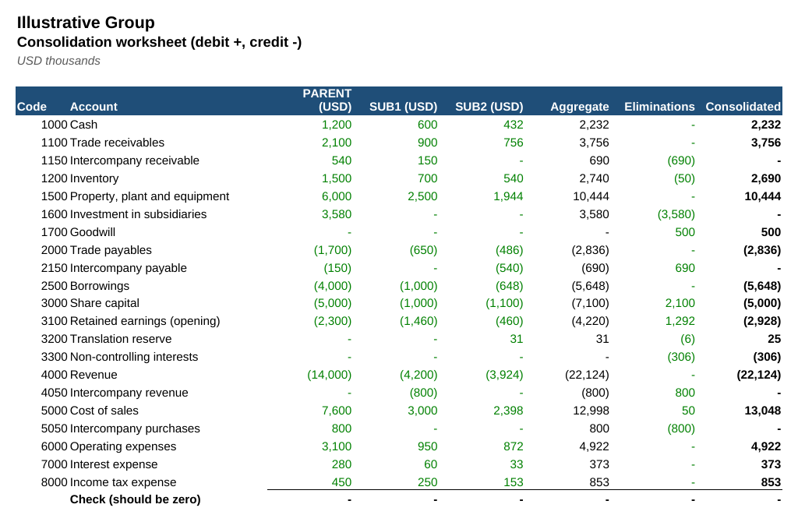
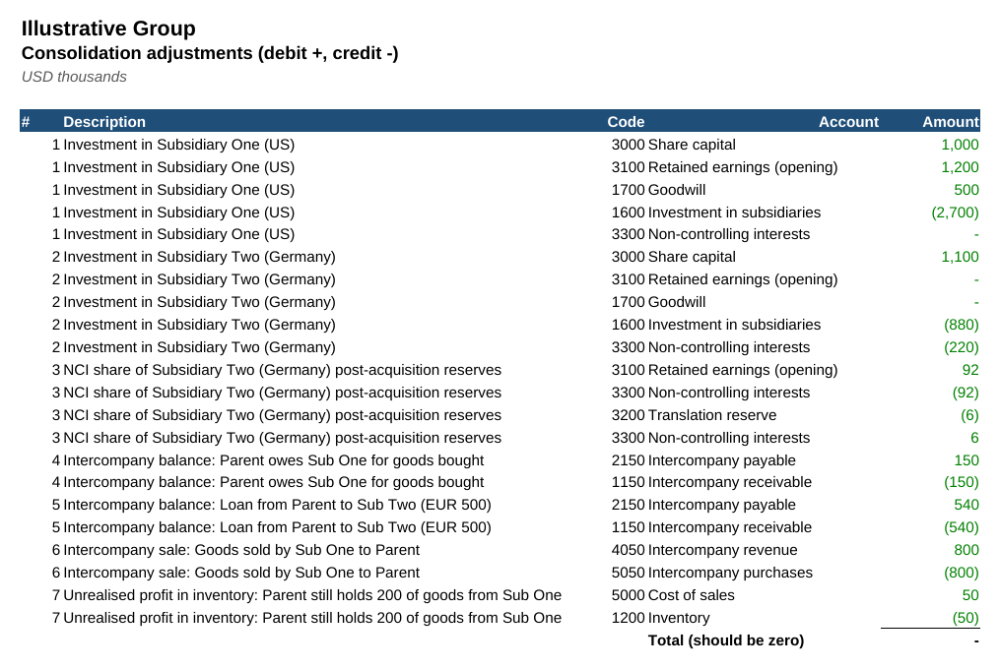
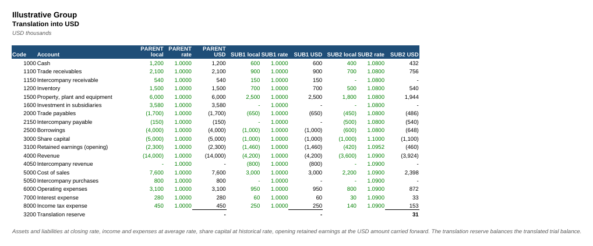
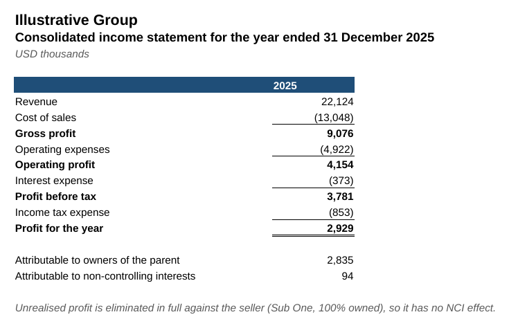
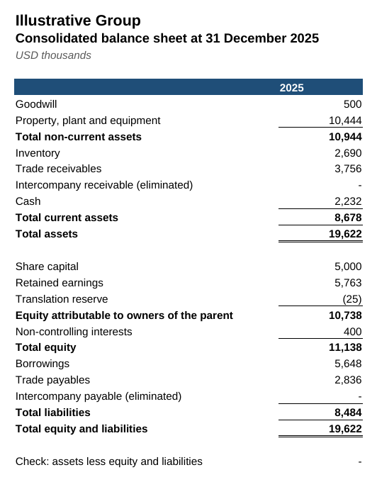

# Multi-Entity Consolidation Workflow

A Python workflow that consolidates a parent and two subsidiaries (one in euros, one 80% owned) into group financial statements, with currency translation, intercompany eliminations, goodwill and non-controlling interests. The output is an Excel workbook where every step is a formula.

**Downloads:** [⬇ Consolidation workbook (Excel)](https://github.com/MuhammedAnshajK/consolidation-workflow/raw/main/output/group_consolidation.xlsx) · [⬇ PDF version](https://github.com/MuhammedAnshajK/consolidation-workflow/raw/main/output/group_consolidation.pdf) · [⬇ Python script](https://github.com/MuhammedAnshajK/consolidation-workflow/raw/main/consolidate.py) · [⬇ Sample trial balances](https://github.com/MuhammedAnshajK/consolidation-workflow/raw/main/data/trial_balances.csv)



## What this does

Group reporting means combining several companies' books into one set of accounts, as if they were a single business. That involves converting foreign currencies, removing everything the companies did with each other, and separating the share that belongs to minority owners. This script does it in one run and checks every step:

```
$ python consolidate.py
Checks passed: 3 trial balances balance, 7 elimination entries balance, intercompany fully eliminated, balance sheet balances.
  Revenue                           22,124.0
  Profit for the year                2,928.7
  Attributable to owners             2,835.0
  Attributable to NCI                   93.7
  Goodwill                             500.0
  Total assets                      19,622.0
  Equity attributable to owners     10,738.4
  Non-controlling interests            399.6
  Total liabilities                  8,484.0
  Total equity and liabilities      19,622.0
Saved output/group_consolidation.xlsx
```

## The group

| Entity | Currency | Owned | Notes |
|---|---|---|---|
| Parent Co. | USD | n/a | Group parent, reporting currency USD |
| Subsidiary One (US) | USD | 100% | Bought for 2,700 when its net assets were 2,200, so goodwill = 500 |
| Subsidiary Two (Germany) | EUR | 80% | Set up by the parent with a partner who holds 20% (non-controlling interest) |

All figures are illustrative, in thousands. No real company data is used.

## Approach

1. **Load and validate.** Reads each entity's trial balance, the chart of accounts, group structure, FX rates and intercompany data. Stops if a trial balance doesn't balance, an account is unknown or a rate is missing.
2. **Translate.** Converts Subsidiary Two from EUR to USD. Assets and liabilities use the closing rate (1.08), income and expenses the average rate (1.09), and share capital the historical rate (1.10). The difference goes to a **translation reserve**.
3. **Eliminate the investment.** Removes the parent's investment against each subsidiary's share capital and pre-acquisition reserves. This creates **goodwill** of 500 for Subsidiary One and a **non-controlling interest** for the 20% of Subsidiary Two the group doesn't own.
4. **Allocate to NCI.** Gives the minority owner its 20% share of Subsidiary Two's post-acquisition reserves, translation reserve and profit for the year.
5. **Eliminate intercompany.** Cancels intercompany balances (150 trade balance, 540 loan), intercompany sales (800), and the **unrealised profit** of 50 on goods still in the parent's inventory.
6. **Check.** Confirms that every elimination entry balances, intercompany accounts net to zero after elimination (any mismatch is reported), and the consolidated balance sheet balances.
7. **Write Excel.** The workbook has eight sheets: Consolidated IS and BS, the consolidation worksheet, the elimination journal, translation, trial balances, inputs and checks. All of them are formulas, so changing an exchange rate or an intercompany amount updates everything.

## Screenshots

| Elimination journal | Currency translation |
|---|---|
|  |  |

| Consolidated income statement | Consolidated balance sheet |
|---|---|
|  |  |

## How to run

```
pip install -r requirements.txt
python consolidate.py
python -m unittest discover tests
```

To consolidate a different group, edit the CSVs in `data/`: one trial balance file with an `entity` column, plus `entities.csv` (currency, ownership, investment cost, pre-acquisition reserves), `fx_rates.csv` and `intercompany.csv`.

## Files

- `consolidate.py`: the workflow (load, validate, translate, eliminate, check, write Excel)
- `data/`: sample trial balances, chart of accounts, entities, FX rates and intercompany data
- `output/group_consolidation.xlsx` and `.pdf`: the generated consolidation
- `tests/`: unit tests, including an intercompany mismatch and an unbalanced trial balance
- `images/`: screenshots

## Tools

Python (pandas, openpyxl), Excel
